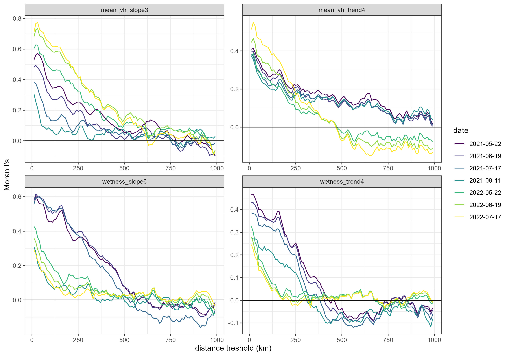

# MoranI-treed-peatlands

How far does spatial autocorrelation extend in satellite-derived wildfire predictors? A Moran's I distance-band analysis used to design **spatially honest cross-validation** for a national wildfire-likelihood model of Canadian treed peatlands.

Supporting analysis for: Pelletier, N., Millard, K., & Darling, S. (2023). Wildfire likelihood in Canadian treed peatlands based on remote-sensing time-series of surface conditions. *Remote Sensing of Environment*, 296, 113747. https://doi.org/10.1016/j.rse.2023.113747

**En bref (FR).** Analyse de l'autocorrélation spatiale (I de Moran par bandes de distance) des covariables satellitaires utilisées pour prédire les feux dans les tourbières boisées du Canada. Les covariables restent autocorrélées jusqu'à environ 500 km, ce qui justifie une validation croisée par blocs spatiaux d'environ 500 × 500 km et un retrait d'une année complète de données pour la validation temporelle.

## Question

Training and validation points for a fire-likelihood model are not independent if nearby sites share the same drought or vegetation signal. Random cross-validation then overstates accuracy. This notebook asks: **beyond what distance do the model covariates stop being spatially autocorrelated?** The answer sets the block size for spatial cross-validation.

## Data

- **Sites:** treed-peatland points larger than 0.25 km²: burned sites intersecting National Burned Area Composite (NBAC) fire perimeters since 2017, and 3,268 never-burned peatland points (shapefiles included).
- **Covariates:** seasonally detrended Sentinel-1 / Sentinel-2 time-series features from the paper, including the 6-month wetness slope (`wetness_slope6`), wetness trend (`wetness_trend4`), VH backscatter slope and trend (`mean_vh_slope3`, `mean_vh_trend4`), evaluated on seven acquisition dates in 2021–2022.

## Method

1. For each covariate × date, define neighbours as all points within an **annulus** (distance band) using `spdep::dnearneigh`, with bands 10 km wide from 1 km to 1,000 km.
2. Row-standardized spatial weights (`nb2listw`, style `"W"`).
3. Moran's I with a **permutation test** (`moran.mc`, 599 permutations) in each band.
4. Run in parallel over covariate–date combinations (`foreach` + `doParallel`).
5. Plot Moran's I against distance by covariate and date.

Results for every combination are in `MoranI_test_Nov2023.csv` (columns: metric, date, distance, moran, p.value).

## Result

On most dates the covariates remain significantly autocorrelated up to **≈500 km**. Curves from the same year are more similar to each other than across years. The long range is expected: the analysis looks at a single land-cover type with seasonality removed, so what remains are regional drought and vegetation signals.

**Implication for validation:** use spatial blocks of roughly 500 × 500 km, and hold out a whole year at a time for temporal validation. Model training itself (random forest, gradient boosting) is less sensitive to autocorrelation than validation is.

## Files

| File | Content |
|---|---|
| `Moran I analysis for treed peatland fire model.Rmd` | Annotated R Markdown tutorial and analysis |
| `Moran-I-analysis-for-treed-peatland-fire-model.html` | Rendered notebook ([preview](https://htmlpreview.github.io/?https://github.com/PelletierN/MoranI-treed-peatlands/blob/main/Moran-I-analysis-for-treed-peatland-fire-model.html)) |
| `MoranI_test_Nov2023.csv` | Moran's I and permutation p-values for all covariate × date × distance combinations |
| `Moran_plot_June2023.jpg` | Summary figure |
| `MoranI_theory.png` | Schematic of positive vs negative spatial autocorrelation |
| `Moran wetness 6 months slope 2021-05-29` | Example single-date correlogram (PNG image without extension) |
| `probablePeatland_*` | Burned and never-burned peatland point shapefiles |
| `references.bib` | Reference for the paper |

## Requirements

R with `sf`, `spdep`, `dplyr`, `ggplot2`, `data.table`, `foreach`, `doParallel`. The covariate table (`training_dataset_Jan2023.csv`) is not included; the precomputed results CSV lets the figures be reproduced without it.

## Related

- [fire-timeseries-ml](https://github.com/PelletierN/fire-timeseries-ml): an independent Python re-implementation of the full pipeline on synthetic data, including spatial-block vs random cross-validation.

## Author

Nicolas Pelletier, Ph.D. (Carleton University, 2023) · https://github.com/PelletierN
